# CostRA — Enterprise Expense Control System

**Индивидуальная работа по дисциплине AWD (PHP)**  
Студент: Rotari Artemii  
Группа: I2502(RU)  
Молдавский государственный университет, факультет математики и информатики

## Содержание

- [Постановка задачи](#постановка-задачи)
- [Технологии и структура проекта](#технологии-и-структура-проекта)
- [Функциональные возможности](#функциональные-возможности)
- [Структура базы данных](#структура-базы-данных)
- [Принцип расчёта бюджета](#принцип-расчёта-бюджета)
- [Запуск проекта](#запуск-проекта)
- [Сценарии работы и скриншоты](#сценарии-работы-и-скриншоты)
- [Безопасность и проверка](#безопасность-и-проверка)
- [Вопросы по реализации](#вопросы-по-реализации)
- [Вывод](#вывод)
- [Источники](#источники)

## Постановка задачи

CostRA — веб-приложение для учёта и согласования расходов предприятия. Оно позволяет сотрудникам подавать заявки на расходы, а администраторам рассматривать их и контролировать месячные бюджеты подразделений.

Цель работы — разработать серверное приложение с регистрацией, аутентификацией, разграничением прав доступа, реляционной базой данных и интерфейсом для работы с расходами.

Проект развивает тему лабораторных работ №5–7. В предыдущих работах основное внимание уделялось обработке форм, объектно-ориентированному коду и хранению расходов. В CostRA к этому добавлены учётные записи, подразделения, согласование заявок и контроль бюджета. Дополнительные механизмы безопасности — математическая CAPTCHA и восстановление пароля по резервному коду. Название объединяет английское слово *cost* (затраты) и инициалы RA. В основе графического знака — стилизованная буква C и три столбца финансовой диаграммы.

Основные этапы: проектирование таблиц, организация доступа к БД, реализация регистрации и ролей, обработка заявок, расчёт бюджетов, разработка интерфейса и проверка сценариев работы.

## Технологии и структура проекта

| Технология | Назначение |
| --- | --- |
| PHP 8.1+ (ветка 8.x) | Серверная логика |
| PostgreSQL | Хранение данных и финансовые расчёты |
| PDO | Подключение к БД и выполнение запросов |
| Composer | Управление зависимостями и автозагрузка PSR-4 |
| Twig 3 | Формирование HTML, наследование шаблонов и экранирование |
| HTML, CSS, JavaScript, SVG | Интерфейс, адаптивная вёрстка, подтверждение удаления и графика |

Приложение использует модульную структуру. Обработчики HTTP-запросов получают данные, проверяют доступ и передают результат шаблону. SQL-запросы сосредоточены в классах доступа к данным, а правила проверки расходов вынесены отдельно. Полноценный MVC-фреймворк не используется.

```text
LI/
├── public/          # Доступные через браузер страницы и assets
│   ├── security.php # Выдача резервного кода после входа
│   └── recover.php  # Публичная форма восстановления
├── src/             # Модель, репозитории, сервисы, валидация, View
│   └── Captcha.php  # Сессионная математическая CAPTCHA
├── templates/       # Twig-шаблоны
├── config/          # Параметры подключения к PostgreSQL
├── bin/             # Создание БД, демоданные, запуск
├── screenshots/     # Примеры интерфейса
├── bootstrap.php    # Инициализация приложения и проверка доступа
├── account-form.php # Общая обработка регистрации
├── expense-form.php # Общая обработка создания и редактирования
├── expense-detail.php
├── month.php
├── schema.sql
├── composer.json
├── composer.lock
├── README.md
└── CostRA_LI_Report_Rotari_Artemii.pdf # Отдельный отчёт
```

| Класс | Ответственность |
| --- | --- |
| `Database` | Создание PDO-соединения |
| `Expense` | Модель расхода |
| `ExpenseRepository` | Чтение, поиск, создание, обновление, согласование и удаление расходов |
| `ExpenseValidator` | Проверка полей расхода |
| `ExpenseService` | Подготовка данных, валидация и сохранение |
| `UserRepository` | Работа с пользователями и подразделениями |
| `Captcha` | Выдача и проверка одноразового примера для каждой публичной формы |
| `AuthService` | Регистрация, вход, выдача резервного кода и восстановление пароля |
| `BudgetRepository` | Чтение и обновление лимитов, расчёт показателей |
| `View` | Вывод Twig-шаблонов, фильтры `currency` и `local_time` |

## Функциональные возможности

### Гость

- Просмотр главной страницы и шести категорий расходов, получаемых из БД.
- Регистрация учётной записи сотрудника и вход в систему.
- Восстановление пароля по заранее сохранённому резервному коду.

### Сотрудник

- Создание и замена своего резервного кода в разделе «Безопасность» (для обеих ролей).
- Просмотр собственного финансового обзора и заявок.
- Создание расхода с указанием названия, суммы, даты, категории, получателя, описания и признака регулярности.
- Поиск по названию, получателю и описанию; фильтрация по категории, статусу и периоду; сортировка по дате или сумме.
- Редактирование своих заявок до принятия решения администратором.
- Просмотр бюджета своего подразделения и результатов согласования.

### Администратор

Дополнительно доступны семь возможностей:

1. Просмотр расходов всех сотрудников и фильтрация по подразделениям.
2. Создание заявки от имени выбранного пользователя.
3. Редактирование любой заявки.
4. Удаление заявки.
5. Одобрение и отклонение ожидающих заявок с прогнозом бюджета.
6. Установка и изменение месячных лимитов подразделений.
7. Просмотр списка пользователей и создание новых администраторов.

Изменение содержимого ранее рассмотренной заявки возвращает её на согласование. Если содержимое не изменилось, прежнее решение сохраняется. Сотрудник не может изменять уже рассмотренный расход.

## Структура базы данных

База `awd_li` содержит пять таблиц.

| Таблица | Основные поля | Назначение |
| --- | --- | --- |
| `departments` | `id`, `name`, `description` | Подразделения предприятия |
| `categories` | `id`, `name`, `description` | Категории расходов |
| `users` | `id`, `department_id`, `username`, `full_name`, `password_hash`, `recovery_code_hash`, `role`, `created_at` | Учётные записи |
| `budgets` | `id`, `department_id`, `month`, `amount` | Месячные лимиты отделов |
| `expenses` | `id`, `user_id`, `category_id`, `title`, `amount`, `expense_date`, `merchant`, `description`, `is_recurring`, `created_at`, `status`, `reviewed_by`, `reviewed_at`, `review_note` | Расходы и решения по ним |

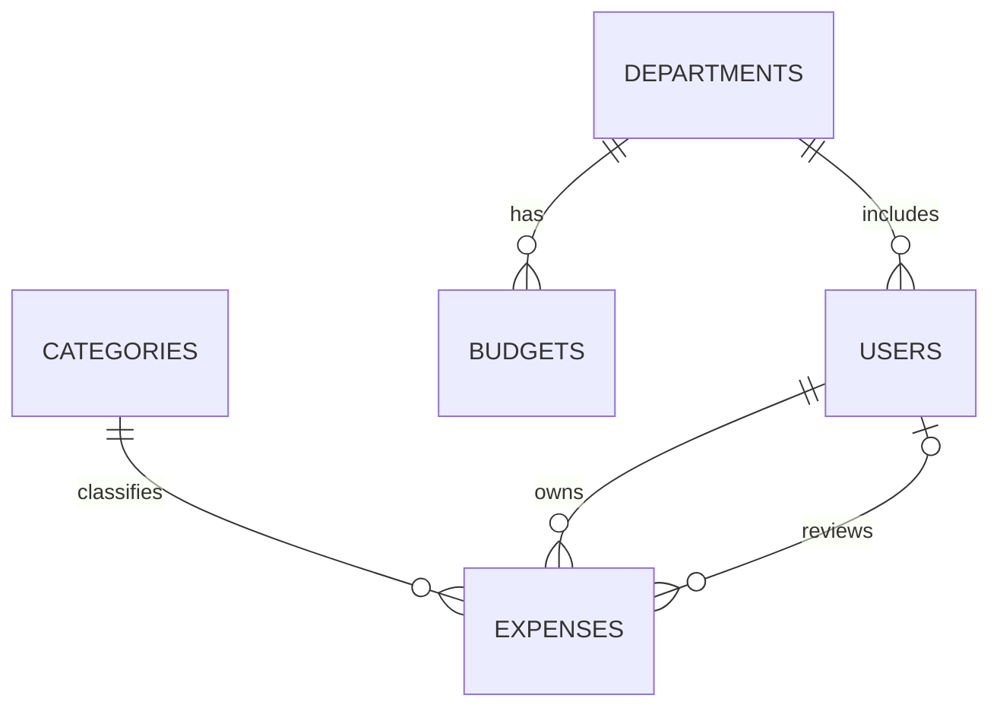

Каждый расход связан с владельцем и категорией. Подразделение расхода определяется через владельца. Поле `reviewed_by` может быть пустым, пока заявка ожидает рассмотрения. Для каждого подразделения и месяца существует не более одного лимита (`UNIQUE(department_id, month)`). Денежные значения хранятся как `NUMERIC(12,2)`, а не как числа с плавающей точкой.

Ограничения `PRIMARY KEY`, `FOREIGN KEY`, `NOT NULL`, `UNIQUE` и `CHECK` поддерживают целостность данных. Например, сумма должна быть положительной, роль и статус должны принимать допустимые значения, а для отклонённой заявки необходим комментарий.

## Принцип расчёта бюджета

В текущем месяце одобренные расходы учитываются в использованном бюджете, ожидающие отображаются отдельно, а отклонённые не уменьшают остаток.

- Остаток = лимит − сумма одобренных расходов.
- Использование бюджета = сумма одобренных расходов / лимит × 100%.
- Прогноз при одобрении = сумма одобренных расходов + сумма рассматриваемой заявки.
- Превышение = положительная разница между прогнозом и лимитом.

В начальных демонстрационных данных Marketing имеет лимит 8 000 MDL, одобренные расходы 6 300 MDL и заявку `Promotional materials` на 2 400 MDL. В случае одобрения будет использовано 8 700 MDL (108,75%), что превышает лимит на 700 MDL. Приложение показывает предупреждение, но оставляет решение администратору.

Если лимит на выбранный месяц не задан, интерфейс сообщает об этом. Полоса использования бюджета становится золотистой начиная с 85%, а при превышении — красной.

## Запуск проекта

### Необходимые компоненты

- PHP 8.1 или новее в ветке 8.x, расширения `pdo`, `pdo_pgsql`, `mbstring`.
- Composer.
- Запущенный PostgreSQL, доступный на `127.0.0.1:5432`. Учётная запись для первого запуска должна иметь права на создание базы и таблиц.
- Windows PowerShell для готового сценария запуска.

### Установка и запуск на Windows

Открыть PowerShell в корне скачанного проекта:

```powershell
composer install
composer check-platform-reqs
```

Сценарий `bin/start.ps1` использует `C:\PHP\php.exe`. Если PHP установлен в другом месте, необходимо изменить переменную `$php` в этом сценарии.

```powershell
powershell.exe -NoProfile -ExecutionPolicy Bypass -File '.\bin\start.ps1'
```

В появившемся окне указать логин и пароль PostgreSQL, затем задать демонстрационный пароль (не менее 8 символов и не более 72 байт UTF-8). Сценарий создаёт `awd_li`, если она отсутствует, применяет `schema.sql`, заполняет пустую БД и запускает локальный PHP-сервер. При наличии данных повторное заполнение пропускается.

Открыть в браузере: `http://127.0.0.1:8000/`.

Для остановки сервера нажать `Ctrl+C` в PowerShell.

При обычном запуске `bin/start.ps1` выполняет `bin/setup.php`. Команда `ALTER TABLE users ADD COLUMN IF NOT EXISTS` в `schema.sql` добавляет поле и существующим установкам. До первой выдачи кода его значение равно NULL.

### Демонстрационные данные

При первом запуске создаются четыре подразделения, шесть категорий, пять пользователей, четыре бюджета на ноябрь 2026 года и двенадцать расходов за октябрь и ноябрь 2026 года. Шесть исходных расходов продолжают примеры предыдущих лабораторных работ.

| Логин | Имя | Роль |
| --- | --- | --- |
| `admin` | Alex Morgan | Администратор |
| `diana` | Diana Brooks | Сотрудник |
| `daniel` | Daniel Reed | Сотрудник |
| `victor` | Victor Hayes | Сотрудник |
| `elena` | Elena Parker | Сотрудник |

Пароль демонстрационных аккаунтов задаётся при первом наполнении и сохраняется только в виде отдельных хешей. На повторном запуске существующие пароли не меняются. Для финансового обзора следует выбрать **ноябрь 2026**.

В чистой базе за этот месяц предусмотрено 10 заявок: 7 одобренных на 22 826,25 MDL, 2 ожидающих на 3 299,90 MDL и 1 отклонённая. Дополнительные записи, созданные через интерфейс, изменяют эти показатели.

## Сценарии работы и скриншоты

### 1. Общедоступная страница

Главная страница доступна без входа в систему. Шесть категорий расходов и их описания выводятся из базы данных.

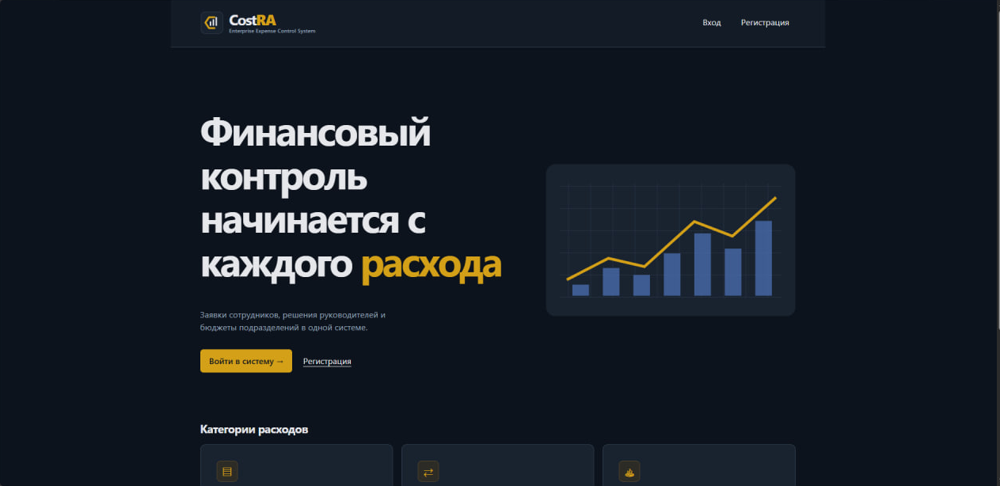

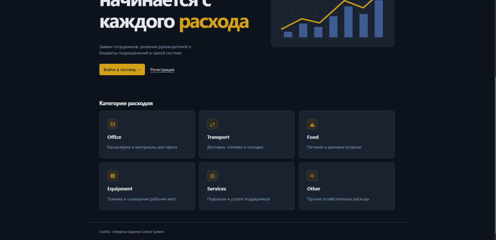

### 2. Вход и регистрация

Гость может зарегистрировать обычную учётную запись, указав имя, подразделение, логин и пароль. При регистрации сотрудника и при входе нужно решить пример на сложение. При создании администратора в разделе «Пользователи» CAPTCHA не используется. После регистрации необходимо войти в систему. Роль администратора не предлагается на публичной форме.

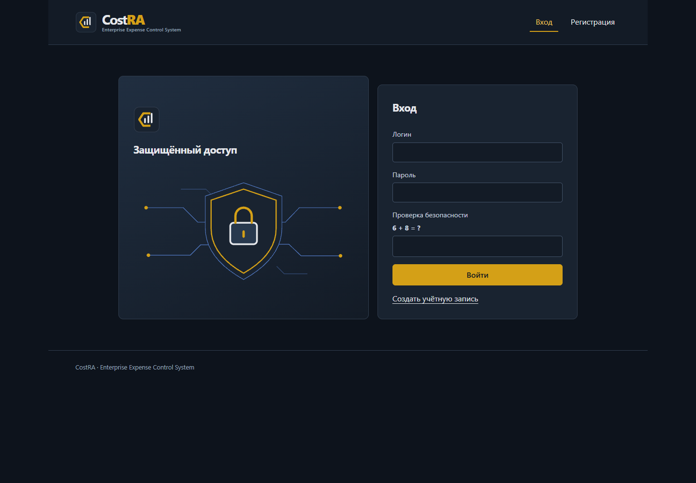

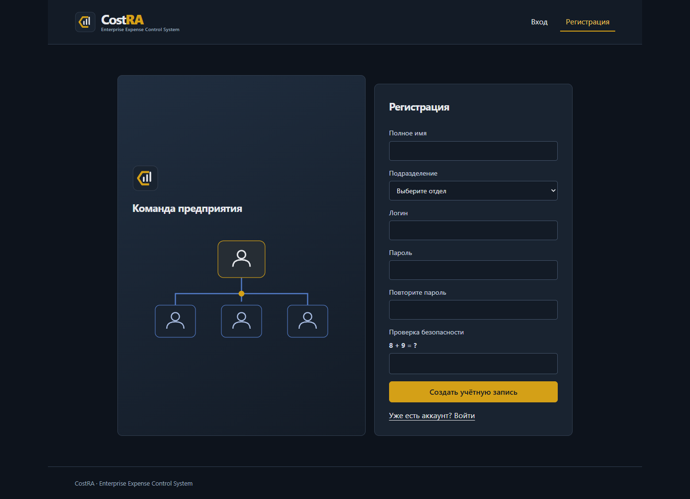

Войдите и откройте «Безопасность». Подтвердите текущий пароль и сохраните показанный один раз резервный код отдельно. Для восстановления нажмите «Забыли пароль?» на странице входа, введите логин, код и новый пароль дважды, решите CAPTCHA. После подтверждения войдите с новым паролем и создайте следующий резервный код.

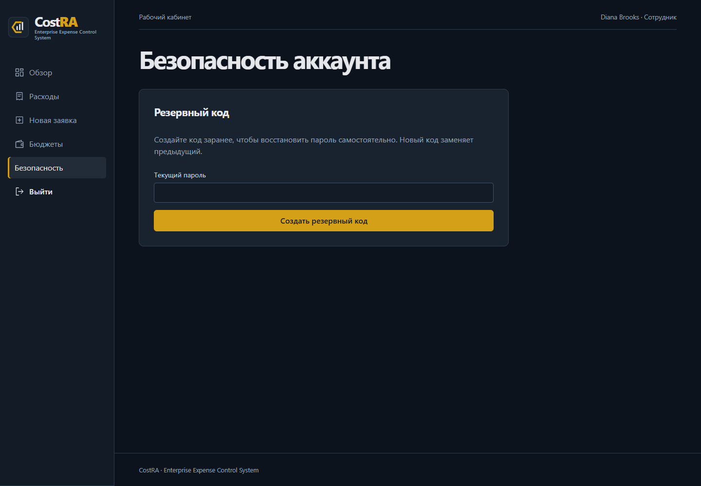

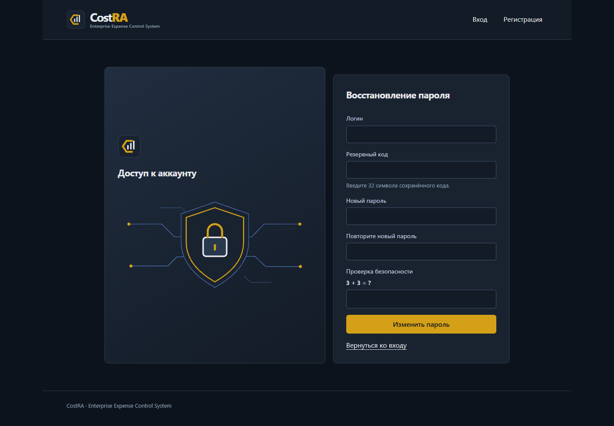

### 3. Финансовый обзор

В обзоре отображается количество заявок, суммы одобренных и ожидающих расходов, число отклонённых заявок, распределение статусов и бюджеты. Администратор видит предприятие целиком, сотрудник — собственные заявки и бюджет своего отдела.

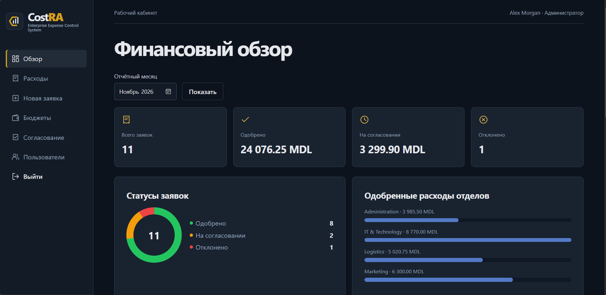

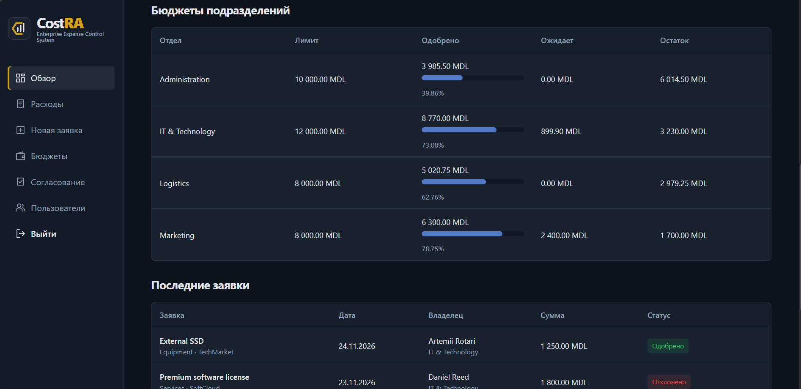

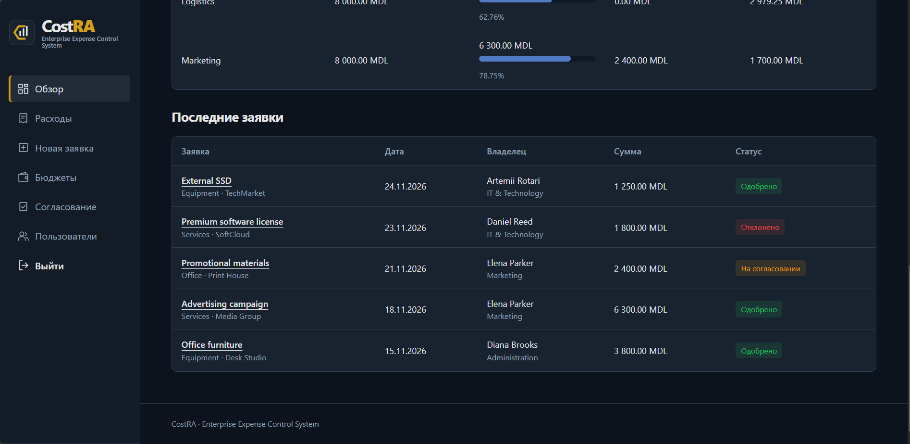

В кабинете сотрудника личные показатели отделены от общих расходов его подразделения.

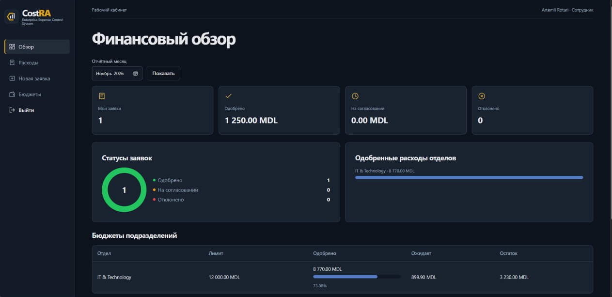

### 4. Создание, поиск и согласование расхода

Сотрудник открывает «Новая заявка», заполняет поля и сохраняет расход. После проверки данных создаётся запись со статусом «На согласовании».

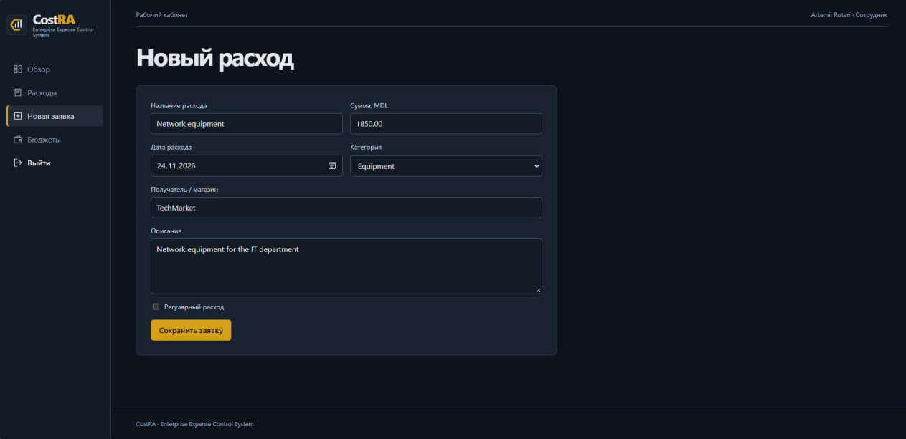

В разделе «Расходы» можно найти заявку по ключевому слову и дополнительно ограничить результаты фильтрами. На примере поиска `SSD` отображается одобренный расход `External SSD`.

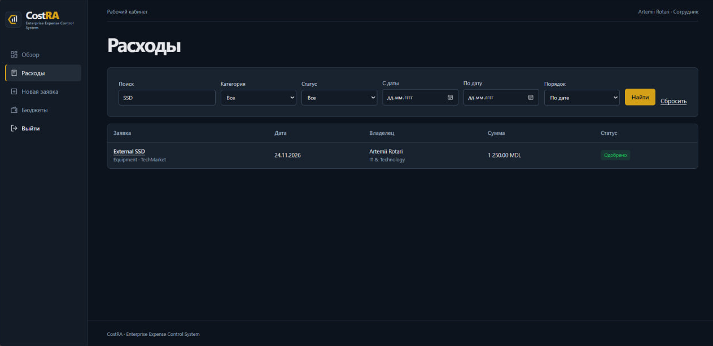

Администратор открывает раздел «Согласование» и выбирает заявку. Перед решением он видит ожидаемое использование бюджета.

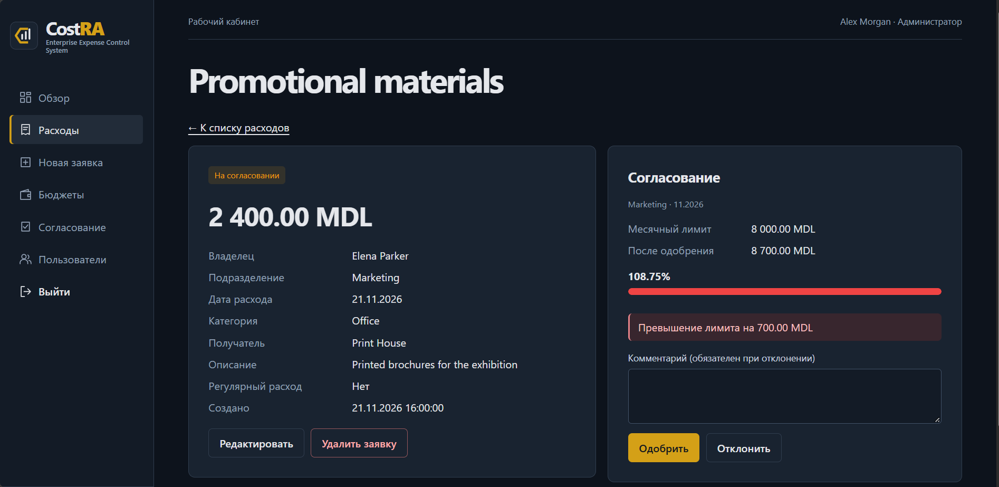

При отклонении обязательно указать причину. Без неё решение не сохраняется.

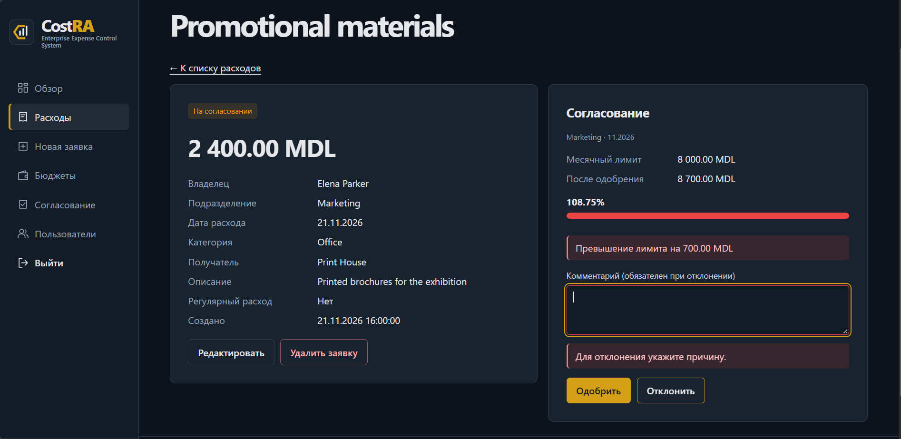

Одобренная заявка содержит данные о принявшем решение администраторе и времени согласования. На примере `External SSD` виден результат ручной проверки полного сценария: создание сотрудником, одобрение администратором и обновление бюджета.

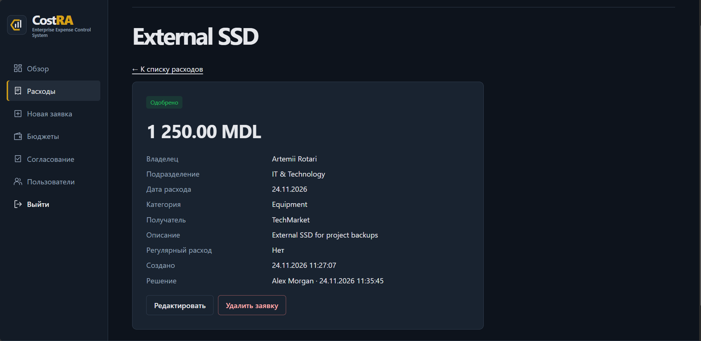

### 5. Администрирование

В разделе «Пользователи» администратор видит учётные записи и их роли. Новые администраторы создаются через отдельную форму. Пароли и хеши в списке не отображаются.

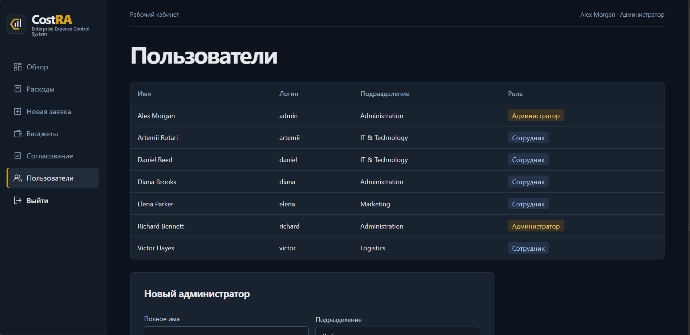

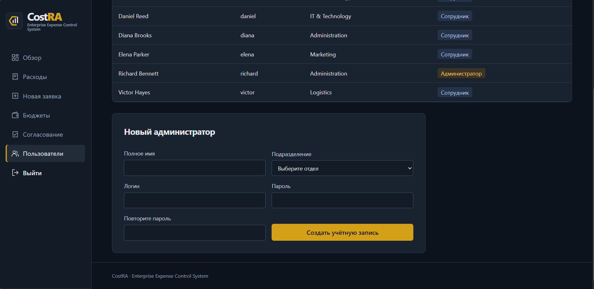

На странице «Бюджеты» администратор выбирает месяц и подразделение, задаёт лимит и сохраняет его. Таблица показывает одобренные и ожидающие расходы, а также остаток по каждому отделу.

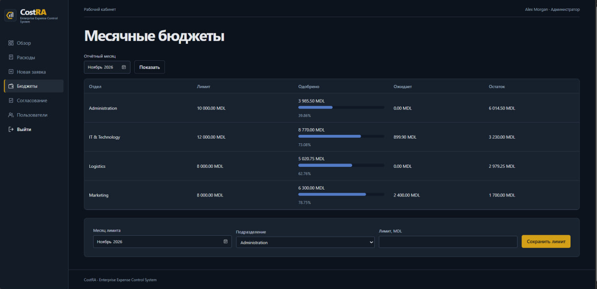

### 6. Ограничение доступа и адаптивность

Сотруднику запрещено редактировать уже рассмотренную заявку даже при непосредственном обращении к её URL (`edit.php?id=13` в демонстрационной базе). Приложение возвращает HTTP 403.

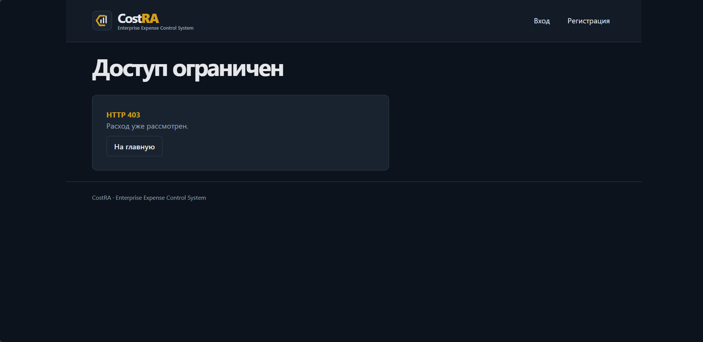

На экране шириной 390 CSS-пикселей карточки и диаграммы перестраиваются в вертикальный формат, а широкие таблицы имеют собственную прокрутку.

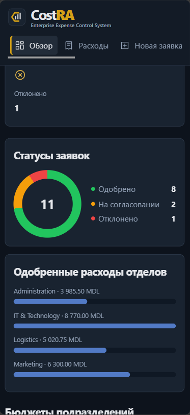

Скриншоты сделаны на работающем локальном приложении после демонстрационных операций. Поэтому количество заявок и состав пользователей на них отличаются от первоначального наполнения БД.

## Безопасность и проверка

Собственные классы, методы и функции документированы PHPDoc: назначение, параметры, результат и значимые исключения. Например, над `ExpenseRepository::createRecord()` описаны объект `Expense`, идентификатор владельца, возвращаемый ID и исключение при некорректном результате БД. Всего в проекте 10 собственных классов, 54 метода и 6 именованных функций.

- Резервный код содержит 128 случайных бит. В `users.recovery_code_hash` хранится SHA-256 кода либо NULL. Условный UPDATE меняет bcrypt-хеш пароля и очищает код за одну операцию. Ранее открытые сессии продолжают действовать.
- Пароли хешируются через `password_hash()` с `PASSWORD_BCRYPT`, проверяются через `password_verify()`. Исходные пароли не сохраняются в таблице пользователей.
- После входа идентификатор сессии обновляется через `session_regenerate_id(true)`. При выходе сессия уничтожается.
- Идентификатор пользователя хранится в сессии, а его роль проверяется по данным БД при каждом запросе.
- Закрытые разделы и административные POST-обработчики проверяют права на сервере. Поиск и чтение расходов сотрудника ограничиваются его идентификатором.
- Изменяющие запросы передаются методом POST и проверяются по CSRF-токену сессии.
- Пользовательские параметры SQL передаются через подготовленные запросы PDO. Варианты сортировки определяются в коде, а не подставляются напрямую из URL.
- HTML-атрибуты форм и PHP-валидатор проверяют обязательные поля, диапазоны, длину, даты и категории. Twig автоматически экранирует вывод HTML.
- Конфигурация берёт учётные данные PostgreSQL из переменных окружения. Корень веб-сервера — `public/`, остальные файлы не предназначены для прямой выдачи браузеру.

Математическая CAPTCHA применяется при входе, публичной регистрации и восстановлении пароля. Ответ и срок действия (300 секунд) хранятся в сессии; каждая попытка погашает пример. Серверная проверка выполняется до обработки учётных данных.

В приложении проверялись регистрация, вход, создание и поиск расхода, редактирование, одобрение, отклонение, удаление, создание администратора, изменение бюджета и отказ в доступе. Пример проверки: заявка на обслуживание автомобиля была создана на 750 MDL, изменена до 850 MDL, отклонена с комментарием и удалена; последующий поиск не вернул запись.

При проверке восстановления в отдельном тестовом окружении были выполнены выдача и замена кода, отказ при неверном пароле или коде, смена пароля, вход с новым паролем и отказ при повторном использовании кода. При двух одновременных запросах с одним кодом пароль изменился только один раз.

Проект предназначен для локальной учебной демонстрации. Резервный код позволяет восстановить доступ без почтового сервера и сбора адресов электронной почты. Код необходимо получить заранее; после его потери восстановление этим способом невозможно. Смена пароля не завершает ранее открытые сессии. Математическая CAPTCHA не заменяет полноценную защиту от ботов и ограничение частоты запросов. Публичный REST API не реализован. Для реального предприятия потребовались бы дополнительные меры, включая HTTPS, контролируемую регистрацию сотрудников и индивидуальные пароли.

## Вопросы по реализации

В предоставленном условии не перечислены конкретные контрольные вопросы. Ниже приведены вопросы по основным механизмам проекта.

**Чем аутентификация отличается от авторизации?**  
Аутентификация проверяет, кто вошёл в систему. Авторизация определяет, какие действия доступны этому пользователю. В CostRA сотрудник не может согласовывать расходы, даже если знает адрес административного обработчика.

**Почему хранится хеш пароля, а не сам пароль?**  
Хеш нужен для проверки введённого пароля без хранения исходной строки. bcrypt использует соль и затратный алгоритм, затрудняющий перебор. При входе `password_verify()` сопоставляет пароль с сохранённым хешем.

**Зачем используются сессии?**  
HTTP сам по себе не сохраняет состояние между запросами. Сессия позволяет связать запросы с вошедшим пользователем. При этом права проверяются на сервере, а не определяются видимостью кнопок.

**Как работает математическая CAPTCHA?**

Класс `App\Captcha` в `src/Captcha.php` выбирает два слагаемых через `random_int()`. PHP хранит сумму и срок действия в сессии отдельно для входа, регистрации и восстановления пароля. В Twig передаётся только вопрос. Браузер проверяет заполнение и формат поля, а сервер погашает пример при попытке отправки и проверяет ответ. Через пять минут пример истекает. Это учебная проверка: простой пример может решить и программа.

**Как реализовано восстановление пароля?**  
В разделе «Безопасность» вошедший пользователь подтверждает текущий пароль. `AuthService::issueRecoveryCode()` создаёт код через `bin2hex(random_bytes(16))` и показывает его один раз. `UserRepository::replaceRecoveryCode()` хранит только SHA-256 кода. В публичной форме `recover.php` проверяются CAPTCHA, CSRF, логин, код и новый пароль. `AuthService::recover()` передаёт хеши в `UserRepository::resetPassword()`: один условный UPDATE заменяет bcrypt-хеш пароля и устанавливает `recovery_code_hash = NULL`. Поэтому код нельзя использовать дважды. Почтовый сервер не нужен; код нужно сохранить до потери пароля.

**Что дают подготовленные запросы PDO?**  
SQL-команда отделяется от её параметров. Значение, введённое в форму, передаётся как данные и не может изменить структуру подготовленного запроса. Имена колонок сортировки выбираются из допустимых вариантов в коде.

**Зачем одновременно нужны клиентская и серверная валидация?**  
Клиентская проверка помогает сразу исправить форму, но её можно обойти. Серверная обязательна, потому что именно сервер принимает решение о записи в БД.

**Что такое CSRF и XSS?**  
CSRF — попытка заставить браузер авторизованного пользователя выполнить нежелательный запрос. CostRA проверяет токен сессии в POST-формах. XSS связан с исполнением внедрённого кода в браузере; автоматическое экранирование Twig не позволяет обычному текстовому значению превратиться в HTML-разметку.

**Зачем отделять Twig от PHP-логики?**  
Шаблоны отвечают за вывод, а PHP — за получение и обработку данных. `extends` и `block` позволяют использовать общий каркас страниц, `include` — повторно применять части интерфейса. Собственные фильтры форматируют денежные значения и время.

**Зачем в обновлении расхода используется транзакция?**  
При редактировании сначала читается текущая запись с блокировкой `FOR UPDATE`. Это позволяет проверить её состояние и изменить её без параллельного согласования между этими операциями. При ошибке выполняется откат.

**Почему сумма имеет тип NUMERIC, а не FLOAT?**  
NUMERIC хранит десятичные денежные значения точно в пределах заданной точности. FLOAT может давать ошибки двоичного округления. Для сравнения бюджетов и расчёта остатка точное представление предпочтительнее.

**Почему дата расхода и время создания обрабатываются по-разному?**  
Дата расхода — календарная дата, её не нужно сдвигать между часовыми поясами. Время создания и согласования записывается в UTC и выводится для Europe/Chisinau с учётом сезонного перевода часов.

## Вывод

CostRA объединяет учёт расходов, регистрацию пользователей, разграничение доступа и управление бюджетами в одном приложении. Основное отличие от обычного списка расходов состоит в том, что заявка проходит согласование, а администратор заранее видит её влияние на бюджет подразделения. Модульная структура позволяет изменять интерфейс и добавлять возможности без переработки всей системы. Дополнительно реализованы математическая CAPTCHA и восстановление пароля по одноразовому резервному коду.

Репозиторий проекта: [rotar-cloud/CostRA](https://github.com/rotar-cloud/CostRA).

Отдельный PDF-отчёт: `CostRA_LI_Report_Rotari_Artemii.pdf` (в комплекте для сдачи).

## Источники

- Учебные материалы курса AWD: PHP, формы и суперглобальные переменные, ООП, организация проекта, Composer.
- [PHP: PDO](https://www.php.net/manual/en/book.pdo.php)
- [PHP: хеширование паролей](https://www.php.net/manual/en/book.password.php)
- [PHP: сессии](https://www.php.net/manual/en/book.session.php)
- [PostgreSQL: ограничения таблиц](https://www.postgresql.org/docs/current/ddl-constraints.html)
- [Twig: документация](https://twig.symfony.com/doc/3.x/)
- [Composer: документация](https://getcomposer.org/doc/)
